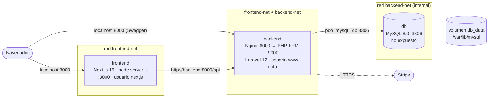

# E-commerce en contenedores · Next.js + Laravel + MySQL

Entorno de **producción con Docker** para el e-commerce del bootcamp:

- **Frontend:** tienda en Next.js 16 (App Router).
- **Backend:** API REST en Laravel 12 con JWT, Swagger y pagos con Stripe.
- **Base de datos:** MySQL 8.

Cada servicio tiene un Dockerfile **multi-stage** que separa la construcción de la ejecución. Así las imágenes quedan livianas, corren sin root y aprovechan la caché de capas de Docker. Todo se levanta con un solo comando: `docker compose up`.

Las dos aplicaciones vienen de actividades anteriores del bootcamp:
[ecommerce-api](https://github.com/themarco155/ecommerce-api) y [ecommerce-frontend](https://github.com/themarco155/ecommerce-frontend).

---

## Arquitectura



| Servicio | Imagen | Puerto | Redes | Qué hace |
|---|---|---|---|---|
| `frontend` | `ecommerce-frontend:1.0` (node:22-alpine) | **3000** → host | frontend-net | Tienda. Lee y escribe en la API desde el servidor, así el token JWT nunca llega al navegador. |
| `backend` | `ecommerce-backend:1.0` (php:8.2-fpm-alpine + Nginx) | **8000** → host | frontend-net, backend-net | API REST, Swagger (`/api/documentation`) y pagos con Stripe. |
| `db` | `mysql:8.0` | 3306 **solo interno** | backend-net | Datos persistentes en el volumen `db_data`. |

**Cómo se conectan:**

- **Dos redes:** `backend-net` está marcada como `internal`, así que MySQL no tiene salida a internet y el frontend no lo puede ver. Solo el backend está en las dos redes.
- **Nombres de servicio:** los contenedores se encuentran por nombre gracias al DNS interno de Docker (`backend`, `db`).
- **Orden de arranque con healthchecks:** primero `db` (`mysqladmin ping`), luego `backend` (`/up` de Laravel) y al final `frontend`. `depends_on: condition: service_healthy` hace que cada uno espere a que el anterior esté **sano**, no solo encendido.

---

## Estructura del repositorio

```
ecommerce-docker/
├── docker-compose.yml          # orquesta los 3 servicios
├── .env.example                # variables documentadas
├── docker/mysql/init/01-init.sh# inicialización de MySQL (1.er arranque)
├── frontend/                   # código Next.js
│   ├── Dockerfile              # deps → build → runner
│   └── .dockerignore
└── backend/                    # código Laravel
    ├── Dockerfile              # base → vendor → runtime
    ├── .dockerignore
    └── docker/
        ├── entrypoint.sh       # cachés, migraciones, seed, arranque
        ├── nginx/nginx.conf    # Nginx sin root → PHP-FPM
        └── php/php.ini, www.conf
```

---

## Cómo ejecutar el ecosistema

**Requisito:** Docker Desktop (Windows o Mac) o Docker Engine con Compose v2 (Linux).

### 1. Clonar y crear el `.env`

```bash
git clone https://github.com/themarco155/ecommerce-docker.git
cd ecommerce-docker
cp .env.example .env          # Windows (CMD): copy .env.example .env
```

### 2. Completar las variables obligatorias

Abre `.env` y define las contraseñas de la base (`DB_PASSWORD` y `DB_ROOT_PASSWORD`), además de `APP_KEY`, `JWT_SECRET` y tus claves de Stripe en modo prueba.

Para generar `APP_KEY` y `JWT_SECRET` (también puedes reusar los del `.env` de tu API local):

```bash
# Linux / Mac / Git Bash
echo "APP_KEY=base64:$(openssl rand -base64 32)"
echo "JWT_SECRET=$(openssl rand -hex 32)"
```

```powershell
# Windows PowerShell
$b = New-Object byte[] 32; [Security.Cryptography.RandomNumberGenerator]::Create().GetBytes($b)
"APP_KEY=base64:" + [Convert]::ToBase64String($b)
$j = New-Object byte[] 32; [Security.Cryptography.RandomNumberGenerator]::Create().GetBytes($j)
"JWT_SECRET=" + -join ($j | ForEach-Object { $_.ToString("x2") })
```

Si falta alguna variable obligatoria, `docker compose` se detiene y te dice cuál es.

### 3. Levantar todo

```bash
docker compose up -d --build
```

En el primer arranque MySQL crea la base, el backend corre las migraciones y carga datos de ejemplo. Puedes seguir el avance con:

```bash
docker compose ps        # estado y salud de cada servicio
docker compose logs -f   # logs en vivo
```

### 4. Usar la aplicación

| Qué | URL |
|---|---|
| Tienda (frontend) | http://localhost:3000 |
| API | http://localhost:8000/api/products |
| Swagger | http://localhost:8000/api/documentation |

Usuario de prueba: `cliente@example.com` / `password123`.
Tarjeta de prueba: Visa aprobada (`pm_card_visa`) o "Tarjeta rechazada" para probar errores.

### Comandos útiles

```bash
docker compose down              # detener (los datos se conservan en el volumen)
docker compose down -v           # detener y BORRAR la base de datos
docker compose build --no-cache  # reconstruir desde cero
docker images "ecommerce-*"      # ver el tamaño final de las imágenes
docker compose exec backend whoami     # → www-data (no es root)
docker compose exec frontend whoami    # → nextjs   (no es root)
```

---

## Decisiones técnicas por Dockerfile

### Frontend · `frontend/Dockerfile`

| Etapa | Base | Qué hace |
|---|---|---|
| `deps` | node:22-alpine | `npm ci` con **solo** `package.json` y `package-lock.json` copiados. |
| `build` | node:22-alpine | Copia el código y corre `next build`. |
| `runner` | node:22-alpine | Imagen final con lo mínimo para el servidor de producción. |

**Por qué está hecho así:**

- **Caché de capas:** los manifiestos se copian antes que el código. Si solo cambias un componente, Docker reutiliza la capa de `npm ci` y no reinstala dependencias. Además, `--mount=type=cache` guarda la caché de npm entre builds.
- **`output: "standalone"`:** Next.js traza qué archivos usa el servidor y genera `.next/standalone/server.js` con solo esos módulos. La imagen final copia únicamente:
  - `.next/standalone`
  - `.next/static`
  - `public`

  Así no lleva `node_modules` completo, ni código fuente, ni TypeScript, ni ESLint. En este proyecto eso pasa de **~620 MB de `node_modules` a ~70 MB** de aplicación. `server.js` es el mismo servidor de producción que usa `next start`.
- **Usuario sin privilegios:** la imagen corre como el usuario `nextjs` (uid 1001).
- **`node:22-alpine` en lugar de `node:20-alpine`:** Node 20 dejó de tener soporte de seguridad en abril de 2026. Node 22 es LTS y es compatible con Next.js 16 (requiere Node ≥ 20.9). La versión se cambia con el argumento `NODE_VERSION`.
- **Variables:** `NEXT_PUBLIC_STRIPE_KEY` entra como **build arg** porque Next.js la incrusta en el JavaScript del navegador. `API_BASE_URL` es una variable **de ejecución** que solo lee el servidor, así que la misma imagen sirve en cualquier entorno.
- **`HEALTHCHECK`:** consulta `/login`, que no depende de la API.
- **`.dockerignore`:** deja fuera `node_modules`, `.next`, `.git` y los `.env`. El contexto de build es pequeño y no se filtran secretos.

### Backend · `backend/Dockerfile`

| Etapa | Base | Qué hace |
|---|---|---|
| `base` | php:8.2-fpm-alpine | Compila `pdo_mysql` y `opcache` y borra las herramientas de compilación **en la misma capa**. |
| `vendor` | base + Composer | `composer install --no-dev`, luego el autoload optimizado. |
| `runtime` | base + Nginx | Código de la app + **solo `vendor/`** copiado de la etapa anterior. |

**Por qué está hecho así:**

- **Extensiones:** `mbstring`, `openssl`, `tokenizer`, `xml`, `ctype` y `json` ya vienen compiladas en la imagen oficial de PHP. Solo se agregan `pdo_mysql` (MySQL) y `opcache` (rendimiento). El build **verifica** que todas estén con `php -m` y falla si falta alguna.
- **PHP 8.2 exacto:** el `composer.lock` de la API incluye `lcobucci/clock 2.3.0`, que solo acepta PHP `~8.1 || ~8.2`. Con PHP 8.3 `composer install` falla. Usar 8.2 garantiza builds reproducibles con las mismas versiones que en desarrollo.
- **Composer en una etapa aparte:** el binario se copia desde `composer:2` y `git`/`unzip` se instalan solo ahí. La imagen final **no** tiene Composer, ni git, ni compiladores.
  - `composer.json` y `composer.lock` se copian antes que el código, así esa capa se reutiliza mientras no cambien las dependencias. También usa `--mount=type=cache`.
  - `--no-dev` saca PHPUnit, Faker, Sail, etc. (`vendor` pasa de ~89 MB a ~59 MB).
  - `--classmap-authoritative` genera un autoload sin búsquedas en disco.
- **Nginx + PHP-FPM en el mismo contenedor:** Nginx es el proxy inverso que pide la arquitectura: recibe HTTP en el puerto 8000 y pasa los `.php` a PHP-FPM en `127.0.0.1:9000`. Va en el mismo contenedor para mantener los **3 servicios** del ecosistema y no tener que compartir el código entre dos contenedores. El `entrypoint` deja PHP-FPM en segundo plano y Nginx como proceso principal.
- **Sin root:** todo el contenedor corre como `www-data`. Por eso Nginx usa el puerto 8000 (no privilegiado) y guarda su PID y temporales en `/tmp`. El código es de root y la app solo lo puede leer; únicamente `storage/` y `bootstrap/cache/` son escribibles.
- **Configuración de producción:**
  - `php.ini-production` con OPcache sin revisar archivos (`validate_timestamps=0`, el código no cambia dentro de la imagen).
  - `expose_php=Off` y `server_tokens off`, para no mostrar versiones.
  - Nginx bloquea archivos ocultos como `.env`.
  - Los logs van a stdout/stderr (`docker compose logs`).
- **`entrypoint.sh`:**
  1. Valida las variables obligatorias.
  2. Genera `config:cache`, `route:cache` y `view:cache` con las variables reales del contenedor.
  3. Corre `migrate --force`, reintentando si MySQL aún no responde.
  4. Siembra datos **solo si la tabla de productos está vacía**, así no se duplican al reiniciar.
  5. Arranca los servidores.
- **`HEALTHCHECK`:** consulta `/up`, la ruta de salud de Laravel 12.

### Base de datos · `mysql:8.0`

- Usa la imagen oficial, configurada solo con variables de entorno: `MYSQL_ROOT_PASSWORD`, `MYSQL_DATABASE`, `MYSQL_USER` y `MYSQL_PASSWORD`.
- **Volumen** `db_data` en `/var/lib/mysql`: los datos sobreviven a `docker compose down` y a reconstruir las imágenes.
- **`docker/mysql/init/01-init.sh`** se monta en `/docker-entrypoint-initdb.d/` y corre solo la primera vez:
  - Deja la base en `utf8mb4_unicode_ci`.
  - Limita los permisos del usuario de la API a su propia base (principio de mínimo privilegio).
- **Sin `ports`:** el 3306 no se publica en el host. Además está en una red `internal`.

### docker-compose.yml

- **Variables obligatorias** con `${VAR:?mensaje}`: si falta una, Compose falla con un mensaje claro en lugar de arrancar mal.
- **`restart: unless-stopped`** en los tres servicios.
- **`security_opt: no-new-privileges`** en todos y **`cap_drop: ALL`** en frontend y backend, que no necesitan ningún permiso especial del kernel.
- **Imágenes con nombre y versión** (`ecommerce-frontend:1.0`, `ecommerce-backend:1.0`) para poder publicarlas en un registro y desplegarlas igual en cualquier entorno.

---

## Solución de problemas

| Problema | Causa y solución |
|---|---|
| `required variable ... is missing a value` | Falta esa variable en `.env` (paso 2). |
| `exec /usr/local/bin/entrypoint: no such file or directory` | El script llegó con saltos de línea de Windows (CRLF). El repo incluye `.gitattributes` para evitarlo; si lo copiaste a mano, guárdalo con LF. |
| `port is already allocated` | El 3000 o el 8000 está ocupado (por ejemplo, `php artisan serve` o `npm run dev`). Ciérralos o cambia `FRONTEND_PORT` / `BACKEND_PORT` en `.env`. |
| El backend queda `unhealthy` | Revisa `docker compose logs backend`. Lo más común es `APP_KEY` sin el prefijo `base64:`. |
| Cambié la contraseña de la base y ya no conecta | MySQL solo lee las variables la primera vez. Corre `docker compose down -v` para recrear la base. |
